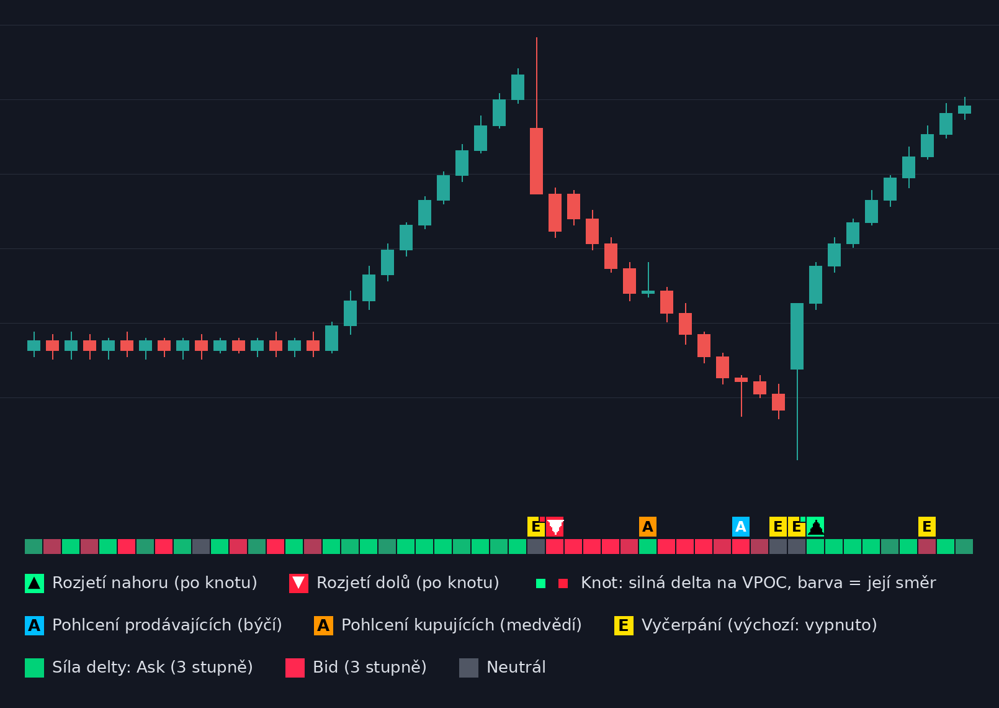

# Delta Strength Bar (ATAS / ATAS X, ES futures)

Dvoupruhová lišta pod cenou:

- **Horní pruh (signály)** ukazuje order-flow události jako výrazné barevné buňky se značkou. **Barva** určuje směr, **značka** typ události.
- **Spodní pruh (síla delty)** ukazuje sílu bid/ask delty každé svíčky: Bid ↔ Neutrál ↔ Ask, ve 3 jasných stupních (slabá / střední / silná).



Náhled je vykreslený kódem indikátoru na simulovaných ES svíčkách, nejde o screenshot z ATASu. Pro ukázku je zapnuté E a okno pro A je zkrácené na 20 svíček.

## Signály

| Značka | Signál | Kdy vznikne |
|---|---|---|
| **•** malý čtvereček | **Knot = první náznak** | VPOC svíčky leží v knotu (≥ 35 % rozsahu, ≥ 3 ticky, knot má ≥ 20 % objemu svíčky) a v zóně VPOC ±1 tick je silná delta (≥ 200 kontraktů a ≥ 15 % objemu zóny). **Barva = očekávaný směr = směr té delty** (nastavení *Expected move: Follow VPOC delta*). Klasické čtení podle strany knotu (dolní = býčí) jde zapnout. Když má svíčka zároveň **A** nebo **E**, knot se ukáže jako tečka v rohu. |
| **▲** zelená / **▼** červená | **Rozjetí pohybu** | Do 3 svíček po knotovém setupu zavře svíčka za tělem knotové svíčky ve směru setupu, s deltou ve směru (≥ 15 % objemu) a close v horních/dolních 40 % rozsahu. Pokud cena mezitím překoná opačný konec svíčky, setup se zruší. Na 5M RTH je to vzácné, 2× za 40 session. |
| **A** modrá | **Pohlcení prodávajících** (býčí) | Delta/objem je silnější než u 80 % a objem vyšší než u 70 % posledních 200 svíček, delta je záporná, ale svíčka zavřela v horních 40 %. Prahy jsou **relativní**, takže fungují v RTH i v noci. |
| **A** oranžová | **Pohlcení kupujících** (medvědí) | Zrcadlově: silný nákup, ale close v dolních 40 %. |
| **E** žlutá | **Vyčerpání** (ve výchozím stavu **vypnuté**) | Nové high (low) za posledních 24 svíček bez podpory delty nebo na slabém objemu. Na 5M RTH nemělo výhodu a označovalo čtvrtinu svíček. |

Když jedna svíčka splní víc podmínek, platí pořadí **rozjetí → pohlcení → vyčerpání → knot**.

**Výchozí nastavení je odladěné na ES 5M RTH**: 40 session od září do listopadu 2026, postup a čísla jsou v `atas/analysis/README.md`.
- Knotové setupy: +2,0 bodu za 15 minut oproti náhodnému vstupu, 59 % úspěšnost, kladné ve všech částech dat.
- A: +3,9 bodu, ale jen 10 signálů.
- Statisticky to prokázané není. Lišta teď označuje 2,7 % svíček místo 27 %.

Signály se kreslí jen na **uzavřených** svíčkách, protože na živé svíčce by mohly ještě zmizet. Dá se to vypnout v nastavení.

Relativní objem se počítá vůči **mediánu**, ne průměru. Jedna obří svíčka (otevření RTH, zprávy, velký knot) by jinak nafoukla průměr na dalších 20 svíček a normální objem by vypadal jako slabý.

## Síla delty

| Mód | Vzorec | Auto saturace |
|---|---|---|
| **Delta % of volume** (výchozí) | `Delta / Volume`, tedy jak jednostranná svíčka byla | 0.30 |
| **Delta / max \|delta\|** | `Delta / max(|Delta|)` za posledních *Lookback* svíček | 0.70 |
| **Delta Z-score** | `(Delta − průměr) / směrodatná odchylka` za *Lookback* | 2.0 σ |

- *Color mode*:
  - **Steps** (výchozí): 3 stupně na stranu, dobře čitelné.
  - **Gradient**: plynulý přechod jako v původní verzi.
- Barvy jsou nově syté: Ask zelená, Bid červená. Neutrál je tmavě šedý, aby barevné buňky vynikly.

## Nastavení

| Skupina | Co obsahuje |
|---|---|
| 1. Calculation | Mode, Lookback, Smoothing, Saturation (0 = auto), Dead zone, Gamma |
| 2. Strength colors | Color mode (Steps/Gradient), Bid / Neutral / Ask, Opacity |
| 3. Signals | zapnutí a prahy pro A, E a ▲▼ / • |
| 4. Signal colors | barvy signálů |
| 5. Layout | Position, výška obou pruhů, Offset, Gap, Border |
| 6. Labels | hodnoty delty v buňkách |

Výchozí prahy jsou pro ES 5M RTH. Na 1M, přes noc a na MES snižte hlavně *Min \|delta\| at VPOC zone*, třeba na 100.

Pro strategie nebo jiné indikátory jsou k dispozici metody:
- `GetSignal(bar)`, která vrací signál dané svíčky,
- `GetStrength(bar)`, která vrací sílu delty v rozsahu ⟨-1, 1⟩.

## Build a instalace

Nejjednodušší je spustit `build-windows.bat` z hlavní složky balíčku, který sestaví a nainstaluje oba indikátory.

Ručně (potřebujete .NET 10 SDK):

```bash
cd atas/DeltaStrengthBar
```

```bash
dotnet build -c Release
```

Výsledný `bin/Release/net10.0/DeltaStrengthBar.dll` zkopírujte do `%APPDATA%\ATAS\Indicators\` (Windows) nebo `~/Library/Application Support/ATAS/Indicators/` (macOS) a restartujte ATAS.

## Ověření

Testy běží proti náhradní kopii ATAS API:
- pohlcení kupujících i prodávajících, a naopak žádný signál, když silná delta zavře ve svém směru,
- vyčerpání přes divergenci delty i přes slabý objem,
- vaše skutečná ES svíčka (VPOC `483 x 157` v horním knotu) → setup, a další svíčka pod tělem → **▼ rozjetí**,
- zrušení setupu po překonání knotu,
- rozjetí jen jednou na jeden setup,
- stejné výsledky při opakovaném přepočtu živé svíčky.

V reálném ATASu se to zatím netestovalo.
